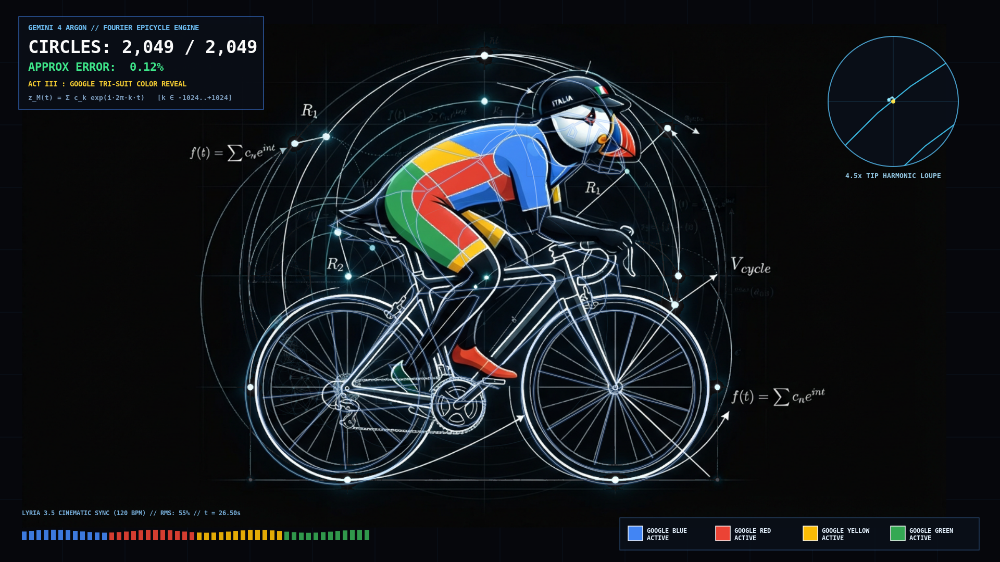
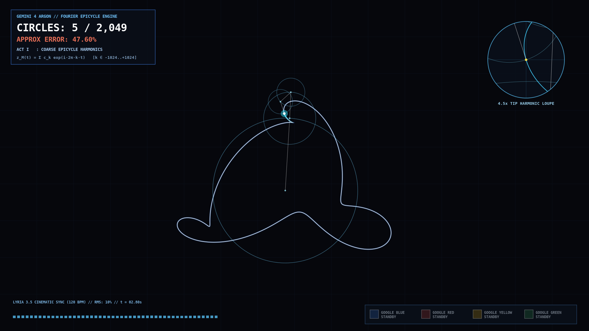
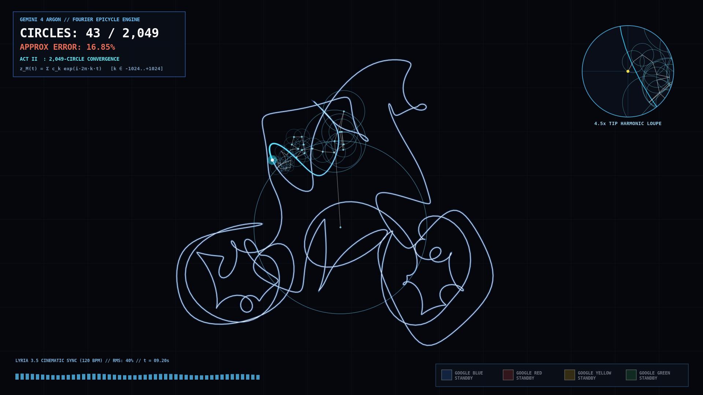
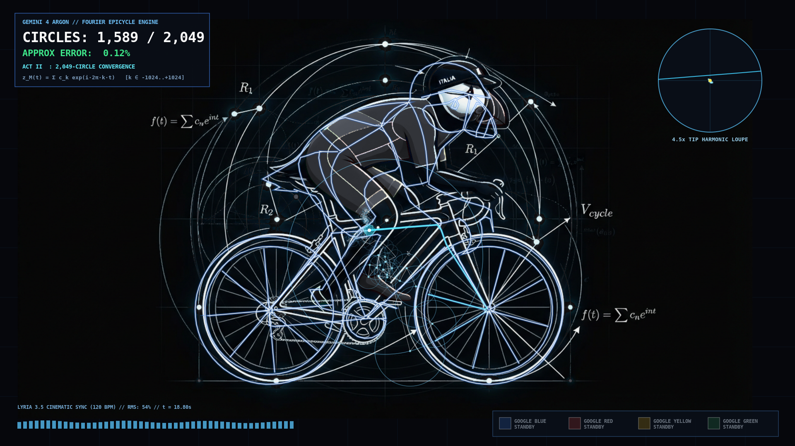

# 🐧🚴‍♂️🇮🇹 Italian Puffin in a Google-Colored Tri-Suit — 2,049 Fourier Epicycles & Lyria 3.5

> 📖 **Read the Full Story & Watch the Native 1080p60 Video on `ricc.rocks`:**
> 👉 **[https://ricc.rocks/en/posts/technology/2026-11-03-fourier-epicycles-italian-puffin/](https://ricc.rocks/en/posts/technology/2026-11-03-fourier-epicycles-italian-puffin/)**
>
> 🎮 **Launch the Live Interactive HTML5 Canvas Studio (Scrub `M = 2..2,049` Circles in Your Browser):**
> 👉 **[https://ricc.rocks/demos/fourier-italian-puffin/](https://ricc.rocks/demos/fourier-italian-puffin/)**

This project is intended for demonstration purposes only. It is not intended for use in a production environment.

---



---

## 🎯 The Two Prompts Behind This Demo (In All Their Unedited Glory)

Inspired by **François Beaufort's (`@fofrAI`)** viral Fourier epicycle showcase ([x.com/fofrAI/status/2110045963951956250](https://x.com/fofrAI/status/2110045963951956250)), we raised the bar on Simon Willison's classic *"Pelican on a Bicycle"* benchmark with an **Italian Twist**: an aerodynamic **Italian Puffin (*Pulcinella di mare*)** wearing an `"ITALIA" 🇮🇹` cycling helmet and a geometric triathlon **tri-suit** riding a road racing bicycle.

Here are the exact, unedited prompts given to the agent—split into the two phases of the workflow:

### 1️⃣ Part 1 — Prompt *"To Get the Job Done"* (Multimodal Generation + 2,049-Circle Fourier Math + Lyria 3.5 Audio Sync)

```text
Make a slow-reveal Fourier epicycle video of an Italian Puffin in a tri-suit riding a bycicle, make the video in the style of the attached reference image, add a cinematic soundtrack using Lyria 3.5 and sync the music. The colors of the trisuit should appear after the epicycles are done, and remind of the four Google colors.

You can use https://x.com/fofrAI/status/2110045963951956250 for inspiration. Create a folder and add artifacts to that folder togethe rwith what you do and all -> I'll use this for a demo / article to show how powerful Gemini is.
```

### 2️⃣ Part 2 — Prompt *"To Write the `ricc.rocks` Article & Generate This Public GitHub Repo"*

```text
Metti l'articolo in ricc.rocks con il video finale in cima :)
ricc.rocks supporta mp4 o solo gif? Aiutami. il video su YT che ho creato uier e' sgranatissimo, low q

puoi creare un demo GH repo pubblico tipo: public-demos-fourier-epicycle-italian-puffin/ ? dove travasi quel codice in/out ma non article e un readme che punti all'articolo?

il prompt che ti ho dato va messo nella sua gloria nel readme e nell'articolo: in due parti:
1. necessario to get job done
2. necessario per scrivere <>quetso articolo e generare <>questo GH repo
```

---

## 🖼️ The 4 Visual Stages of the Slow-Reveal

| Stage 1 (`M = 5` circles, `46.29%` error) | Stage 2 (`M = 43` circles, `16.57%` error) |
| :---: | :---: |
|  |  |
| **Stage 3 (`M = 2,049` circles, `0.12%` error — Monochrome Lock)** | **Stage 4 (Post-Epicycle Google 4-Color Tri-Suit & `🇮🇹` Reveal)** |
|  |  |

---

## 🧮 Mathematical Architecture (`2,049` Complex Harmonics)

Any closed 2D contour sampled at $N = 2,049$ uniform arc-length points (centered on its exact geometric centroid `(703.87, 456.74)` so the $k=0$ DC offset vanishes) can be represented as a discrete complex signal $z_n = x_n + i y_n$.

Using the **Discrete Fourier Transform (DFT)** across symmetric frequencies $k \in [-1024, +1024]$, [`src/build_contour.py`](src/build_contour.py) computes each complex harmonic coefficient:

$$X_k = \frac{1}{N} \sum_{n=0}^{N-1} z_n \, e^{-i \frac{2\pi k n}{N}} = A_k e^{i \phi_k}$$

Sorting all $2,049$ harmonics by descending amplitude ($A_{k_1} \ge A_{k_2} \ge \dots \ge A_{k_{2049}}$) reconstructs the partial contour $z_M(t)$ at any harmonic truncation $M \in [2, 2049]$:

$$z_M(t) = \sum_{m=1}^{M} X_{k_m} \, e^{i 2\pi k_m t}, \quad t \in [0, 1)$$

| Harmonic Tier (`M` Circles) | Video Timestamp (`t`) | Relative L2 Error | Visual Milestone |
| ---: | :---: | ---: | :--- |
| **`2` circles** | `0.0s` | `60.20%` | Single elliptical orbit |
| **`5` circles** | `2.8s` | `46.29%` | Cosmic figure-eight loop |
| **`16` circles** | `6.0s` | `31.12%` | Front & rear wheel lobes separate from torso |
| **`50` circles** | `9.5s` | `14.16%` | Bicycle frame & hunched Puffin silhouette emerge |
| **`165` circles** | `13.0s` | `2.35%` | Helmet, iconic beak, handlebars & spokes lock in |
| **`580` circles** | `16.0s` | `0.33%` | Tri-suit geometric panel seams & crankset sharpen |
| **`2,049` circles** | `19.6s` | `0.12%` | Sub-pixel convergence across all 2,049 harmonics |

---

## 📂 Repository Structure

```text
public-demos-fourier-epicycle-italian-puffin/
├── README.md                                    # Overview, 2-part prompt & link to ricc.rocks article
├── justfile                                     # Reproducible build & verification pipeline
├── LICENSE                                      # Apache-2.0 License
├── CONTRIBUTING.md                              # Google CLA & contribution guidelines
├── VERSION                                      # Semantic version (0.1.0)
├── CHANGELOG.md                                 # Release history
├── assets/
│   ├── reference_italian_puffin_trisuit.png     # 16:9 Reference blueprint illustration
│   ├── soundtrack_lyria35.mp3                   # 30.77s 120 BPM 3-Act Google Lyria 3.5 soundtrack
│   ├── soundtrack_lyria35.txt                   # Lyria 3.5 prompt, acoustic caption & metadata
│   ├── beat_envelope.json                       # 60fps RMS, low-bass & high-onset audio curves
│   ├── fourier_2049_coeffs.json                 # Exact 2,049 complex DFT coefficients (k=-1024..1024)
│   ├── layer_mono.png                           # Desaturated stealth wireframe blueprint layer
│   ├── layer_google_blue.png                    # Isolated #4285F4 Google Blue tri-suit layer
│   ├── layer_google_red.png                     # Isolated #EA4335 Google Red tri-suit layer
│   ├── layer_google_yellow.png                  # Isolated #FBBC05 Google Yellow tri-suit layer
│   ├── layer_google_green.png                   # Isolated #34A853 Google Green tri-suit layer
│   └── layer_italia_accents.png                 # Isolated Puffin beak & 🇮🇹 ITALIA helmet accents
├── src/
│   ├── inspect_image.py                         # 60fps audio envelope & beat extractor
│   ├── prepare_color_layers.py                  # Chromatic isolation & monochrome blueprint splitter
│   ├── build_contour.py                         # 2,049-point closed contour & DFT solver
│   ├── render_fourier_video.py                  # PyCairo + FFmpeg 1920x1080 60fps video renderer
│   └── build_interactive_html.py                # Self-contained HTML5 Canvas studio generator
├── interactive/
│   └── index.html                               # Interactive browser player (scrub harmonics 2..2049)
└── output/
    ├── italian_puffin_fourier_epicycles.mp4     # Final 1920x1080 60fps MP4 with synced Lyria 3.5 audio
    ├── stage1_coarse_circles.png                # Still 1: Act I Coarse Harmonics (M=5 circles)
    ├── stage2_mid_circles.png                # Still 2: Act II Mid Convergence (M=43 circles)
    ├── stage3_full_2049_epicycles_mono.png      # Still 3: Act II 2,049 Circles + Monochrome Lock
    └── stage4_google_trisuit_color_reveal.png   # Still 4: Act III Post-Epicycle Google 4-Color Reveal
```

---

## 🚀 Quickstart

```bash
# Verify precomputed coefficients, audio envelopes, and video outputs
just test

# Launch the interactive HTML5 Canvas Fourier Studio locally at http://localhost:8088/interactive/
just serve

# Re-run the full mathematical & video rendering pipeline from scratch (requires python3-cairo & ffmpeg)
just all
```

---

## 📖 Companion Article

Read the full deep-dive article (with embedded 1080p60 video, audio player, and YouTube 4K VP9/AV1 encoding notes) on **Riccardo's Blog (`ricc.rocks`)**:
👉 **[https://ricc.rocks/en/posts/technology/2026-11-03-fourier-epicycles-italian-puffin/](https://ricc.rocks/en/posts/technology/2026-11-03-fourier-epicycles-italian-puffin/)**
